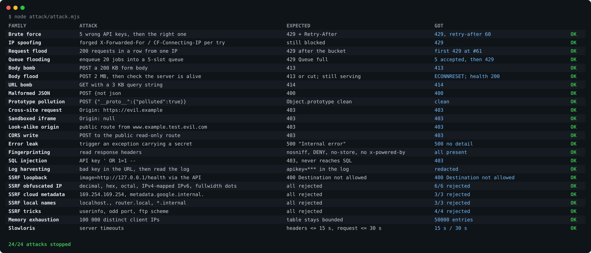

# hardened-node-backend

**Make a small Node backend survive the real internet, with zero dependencies.** A drop-in hardening layer for `node:http` servers, an attack battery that proves every protection, checklists for Node and FastAPI, and a systemd + Litestream deployment that comes back on its own.



## Why

"Unhackable" does not exist. What a solo or small-team backend can have is a minimal surface, failures that do little damage, early warning and fast recovery. Most self-hosted APIs skip the boring parts: per-IP limits, hashed keys, SSRF checks, bounded bodies, errors without stack traces, logs without secrets, a queue that survives a crash, a restore that has actually been tried. This kit packs those parts into ten small ES modules with no dependencies, and every protection ships with the attack it stops.

## Quickstart

Requires Node 22.13 or later (`node:sqlite`).

```bash
npm test                 # unit tests + the full attack battery
npm run attack           # the attack table on the terminal (--json, --svg out.svg)
npm run example          # demo server on 127.0.0.1:8787
```

Apply it to your own server (see `examples/server.js`):

```js
import http from 'node:http';
import { harden, createLogger, forbidden } from './src/index.js';

const server = http.createServer();
const { wrap } = harden(server, { ownOrigin: 'https://api.example.com', behindTunnel: true, logger: createLogger(), json: true });

server.on('request', wrap(async (req, res, ctx) => {
  const body = await ctx.readBody();            // bounded, JSON or form
  if (!valid(ctx.params.apikey)) { ctx.failures.fail(ctx.ip); throw forbidden('Invalid API key'); }
  // ctx.ip is the real client IP; errors become clean HTTP answers
}));
server.listen(8787, '127.0.0.1');
```

## What each module covers, and what it stops

| Module | What it does | Attack it stops |
|---|---|---|
| `index.js` · `harden()` | one funnel per request: URL length, Origin, per-IP limits, headers, bounded body, server timeouts | URL bombs, cross-site calls, slowloris |
| `clientIp.js` | real client IP, trusting forwarded headers only from a local tunnel | IP spoofing to dodge limits |
| `rateLimit.js` | token bucket per IP + failure counter that blocks an IP; both with bounded memory | floods, brute force, memory exhaustion |
| `apiKeys.js` | 128-bit keys, peppered SHA-256 at rest, prefix lookup, constant-time compare, shape check | stolen databases, timing attacks, injection-shaped keys |
| `ssrfGuard.js` | `checkUrl()` and `safeFetch()`: private IPv4/IPv6 ranges, internal names, ports, credentials, DNS pinning, re-checked redirects, size and time caps | SSRF into the LAN or cloud metadata, DNS rebinding, obfuscated IPs |
| `headers.js` | `nosniff`, `DENY`, `no-store`, strict CSP, no `X-Powered-By`, HSTS behind the tunnel | clickjacking, MIME sniffing, fingerprinting |
| `errors.js` | fixed messages per status, everything else a plain 500 | stack-trace and secret leaks |
| `logger.js` | JSON lines, keys/tokens/passwords/phone numbers redacted, size rotation | log harvesting |
| `persistentQueue.js` | SQLite job queue with a cap, backoff retries, crash recovery | queue flooding, lost work on crash |
| `shutdown.js` | graceful stop on SIGTERM; log and exit on unknown errors | half-broken processes serving traffic |

The attack battery (`attack/attack.mjs`) boots the example server in-process on `127.0.0.1`, runs 24 attack families against it and prints attack, expected, got and OK. Copy it next to your app and point it at your own server factory. It never talks to anything it did not start itself.

## What else is in the box

| Folder | Contents |
|---|---|
| `checklists/` | `NODE.md` (apply the kit in ten minutes), `FASTAPI.md` (local FastAPI backends), `ASVS_L1.md` (OWASP ASVS 5.0 L1 mapped to kit vs app) |
| `docs/` | `GUIDE.md` (the layers from the edge to the backup), `THREAT_MODEL.md` (STRIDE template already filled for the kit), `INCIDENT_PLAYBOOK.md` (what to do at 3 a.m.) |
| `resilience/` | dedicated box (WSL2, VM or VPS), hardened systemd units, Litestream replica, outbound tunnel template, health watchdog, SHA256-checked tool installer |

## Tests

```bash
npm test
```

Node's built-in runner, no packages to install: 11 tests written as attacks (brute force, bursts, huge bodies, foreign origins, SSRF variants, redaction, queue crash recovery) plus the full battery, which must stop 24 out of 24. Everything runs on the loopback interface; one SSRF check uses a literal public IP and needs no network.

## Lessons learnt

- Behind a tunnel every client looks like `127.0.0.1`. Forget `behindTunnel: true` and one blocked attacker blocks everybody.
- The trailing dot of a fully qualified name (`localhost.`) slips past naive name lists. Strip it before checking.
- Checking a URL is not enough: resolve it, check **every** address, then connect to the checked IP, or DNS rebinding walks straight in.
- A body over the cap is drained up to four times the limit so the client gets a clean 413, and beyond that the socket is cut.

## Built with AI-assisted workflows

Made by a motion and creative technologist working with AI agents. The kit came out of hardening small self-hosted services and turning every finding into a module, a test and an attack that proves it.

Licence: GPL-3.0-or-later (see `LICENSE`)

**Commercial licence.** If you want to use it in a closed product without the GPL obligations, a commercial licence is available: thejunglefruit@proton.me
